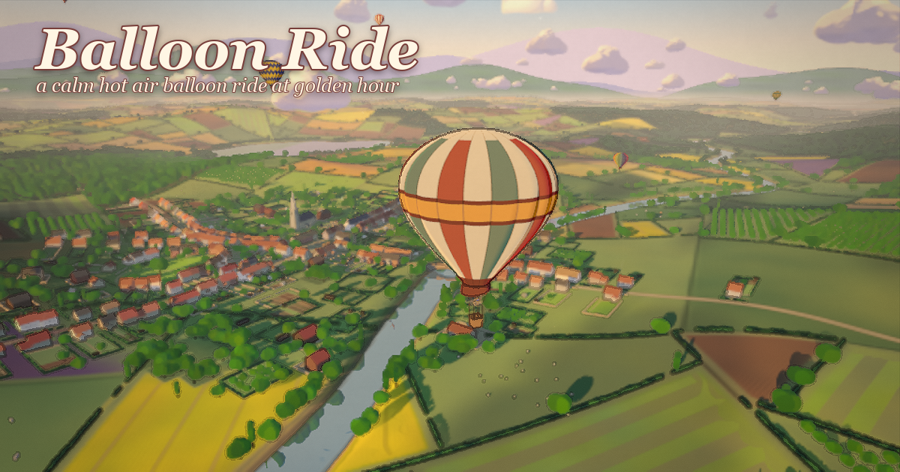
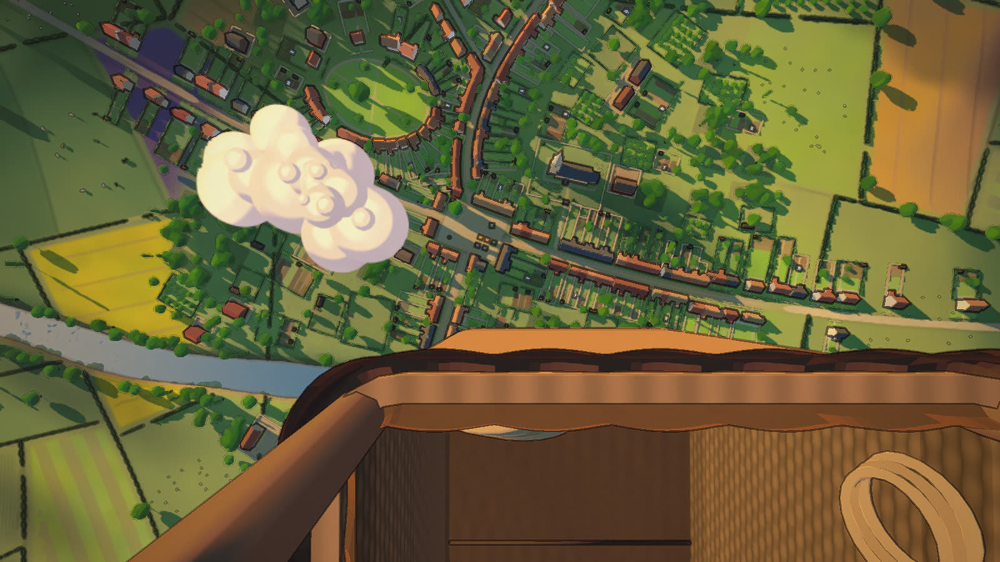
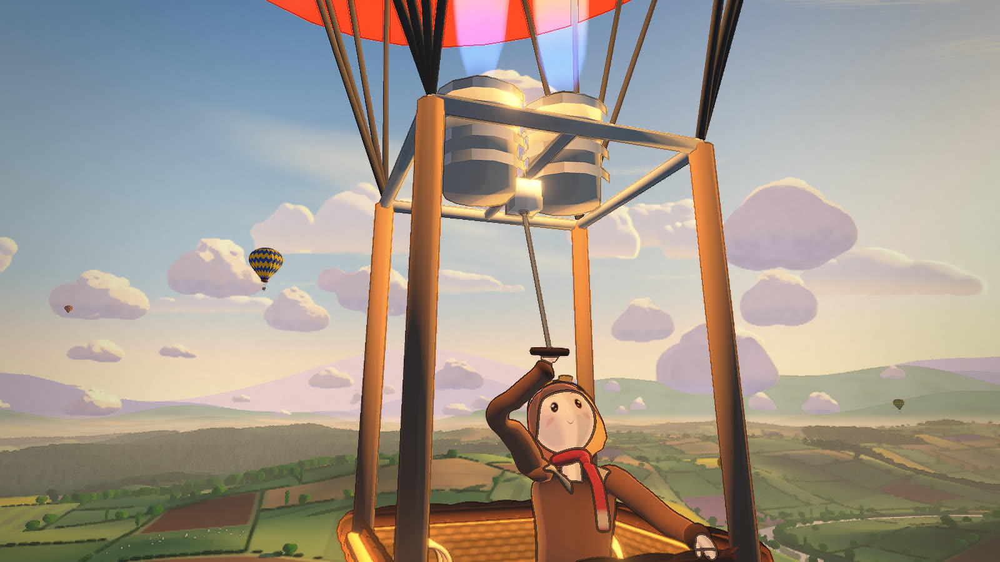
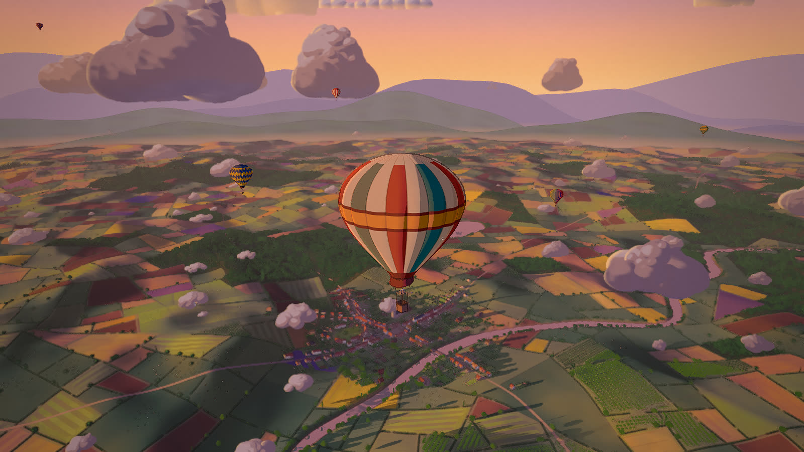
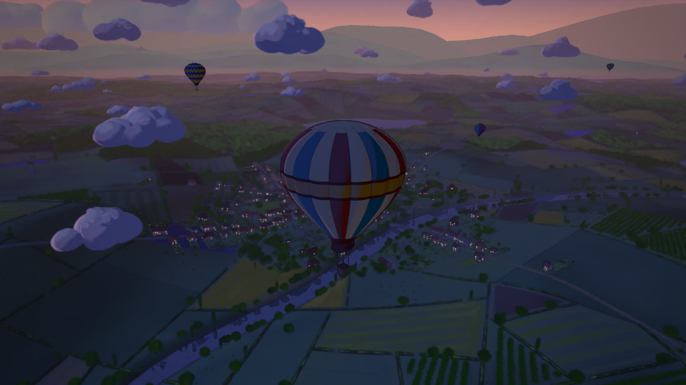

# Balloon Ride

A hot air balloon ride over a painted English-style countryside at golden hour, built in Three.js.
There is no score and nothing to win. You fire the burner, drift with the wind and look down at a
miniature world: a village of 482 buildings around a church and a green, a windmill on its hill, a
river under a stone bridge, a lake, 6.7k patchwork fields edged with hedgerows, orchards and woods,
and sheep and cows grazing in the pastures. Five other balloons drift at other heights. The pilot
in your basket pulls the burner lever when you hold Space.

The world is generated in code at load time: the terrain, fields, village, trees, clouds, sky and
every sound. The only authored models are the balloon and the pilot, and Python scripts build both
in Blender. No textures, models or sounds were downloaded.



**Fly it: https://starknightt.github.io/balloon-ride/**

On a computer you need a keyboard and a mouse; it was built and measured in Chrome on an RTX 4060.
Phones and tablets get touch buttons and a lighter quality tier, so far tested only in browser
emulation (see [Limitations](#limitations)).

## Running it locally

```
git clone https://github.com/StarKnightt/balloon-ride.git
cd balloon-ride
pnpm install
pnpm dev        # http://localhost:5441
pnpm build      # type-check, then a production build into dist/
pnpm preview    # serve dist/ on http://localhost:5440
```

The only runtime dependency is `three`. The build uses a relative base, so `dist/` works from any
sub-path. GitHub Pages is deployed by `.github/workflows/deploy.yml`
(`gh workflow run deploy.yml` starts it by hand).

Two capture scripts drive the real build in headless Chromium:

```
pnpm shoot p7   # fixed comparison frames into shots/p7/ (ground, 50 m, 200 m, 500 m, down, basket, ...)
pnpm record     # the cinematic to recordings/balloon-ride-cinematic.mp4, 1920x1080 at 60 fps
```

Both need a hardware GPU. They print the WebGL renderer on every run and refuse to continue on a
software rasteriser, and any shader compile or link error fails the run. `record` also needs an
ffmpeg build with NVENC on the `PATH`.



## Controls

| Input | Action |
|---|---|
| Space (hold) | Fire the burner. The air in the envelope heats and the balloon starts to climb a few seconds later |
| S or Down (hold) | Open the vent. The balloon sinks |
| Mouse drag | Look around. In the chase view the wheel zooms between 30 and 95 m |
| V | Switch between the chase view behind the balloon and the view from the basket |
| T | Next time of day: sunrise, golden hour, sunset, blue hour (a 3 s fade) |
| C | Cinematic camera; C again hands control back where it ends |
| M | Mute |
| H | Show or hide the controls hint |

The screen stays clean while you fly. Nothing is drawn over the scene until you press H, and then
only a small hint in the lower left.

### Steering

A balloon has no steering wheel, and neither does this one. The wind blows a different way at each
height, and you choose your direction by climbing or sinking into the layer you want:

| Layer | Wind |
|---|---|
| Below 150 m | East, 2.5 m/s |
| 150 to 400 m | North-east, 4 m/s |
| Above 400 m | North, 6 m/s |

The layers blend over 40 m at each boundary and gust by about 10 per cent. Dandelion fluff and
motes drifting past the basket, and the clouds of each layer, show you which way you're going. If
you drift more than 2.2 km from the village, the wind quietly turns you back towards it.

### Touch

| Touch | Action |
|---|---|
| Flame button (lower left, hold) | Burner |
| Vent button (lower right, hold) | Vent |
| Eye button (above the vent) | Chase view or basket view |
| Drag anywhere else | Look around |

### URL options

| Option | Effect |
|---|---|
| `time=sunset` | Starts at `sunrise`, `golden` (default), `sunset` or `blue` |
| `cinematic=1` | Starts straight into the cinematic camera |
| `seed=1` | Seeds the world layout: terrain, fields, crops, village, trees and animals |
| `mobile=1` | Touch buttons and the phone tier on a desktop |
| `msaa=0\|2\|4` | Sets the anti-aliasing level |
| `kuwahara=0` | Turns the paint filter off, for comparison |

## What is in it

- **The balloon.** A 20.5 m envelope built from 20 gores on an inverted-pear profile, with stripes
  that follow the gores, a gold equator band, a skirt, load tapes and flying wires down to a burner
  frame with twin burner cans over a padded wicker basket. While the burner fires, the flame grows
  from a 0.16 m pilot light to about 2.3 m, and its flickering light warms the inside of the
  envelope, the skirt and the basket.
- **The pilot.** An original character in a brown flying jacket with a long red scarf and brass
  goggles pushed up on her cap. She rests her hands on the rim, leans over now and then to look
  down, and reaches up to pull the burner lever while you hold Space. Her scarf blows in the wind
  the whole time. In the basket view only her hand and forearm show, so she never blocks the view.
- **The countryside.** About 6 km of rolling land around a village: joined terraces along the
  lanes, back gardens with veg rows, sheds and greenhouses, a market square, a church with a spire
  in a walled churchyard, a turning windmill and 12 farmsteads. A meandering river runs under a
  stone arch bridge, and a lake mirrors the sky. Fields come as pasture, hay, wheat, rapeseed,
  lavender and ploughed earth, edged by hedgerows with gates, alongside orchards, allotments and
  woods on the hills. Distant land fades into warm haze.
- **Life.** 1,123 sheep and 250 cows drifting slowly across 72 pastures, carts and cars on the
  roads, smoke from about half the chimneys leaning downwind, and two flocks of birds circling below
  you.
- **Clouds you can fly through.** 70 low puffs around 250 to 330 m that you can rise up through and
  pop out above, 34 cumulus around 600 m, and high cirrus. Each layer drifts with its own wind and
  casts shadows on the fields. Inside a cloud the view goes to a soft, luminous fog.
- **A balloon festival.** Five other balloons in their own patterns (blue and yellow chevrons,
  rainbow gores, red and white, green and gold diamonds, a purple and orange spiral) fly at 80, 210,
  330, 480 and 700 m. Each one drifts with its own layer's wind, so they spread apart and pass you as
  you change height.
- **Four times of day.** Sunrise with mist lying in the valleys, golden hour, a deep orange and rose
  sunset, and blue hour with stars, lit cottage windows and the burner's glow on the skirt.
- **A cinematic camera.** A 50-second shot that opens on the pilot firing the burner, pulls back
  round the balloon to reveal the village, the river and the festival, then glides out over the
  golden fields.
- **Sound, all synthesized.** A pulsing burner roar with an ignition whoosh and a falling tail, the
  hiss of the vent, wind that rises with height, larks and songbirds over the fields that thin out
  as you climb, rounds rung on six church bells near the village, and the creak of the wicker.



## How it works

### Flight

`src/flight/physics.ts` models the air in the envelope, not the balloon's speed. The burner adds
heat, the vent takes it away, and the envelope cools on its own towards a slow sink. Lift follows
the heat with a five-second lag and the balloon's speed follows lift with three seconds of inertia,
so a burn takes effect a few seconds after you start it and keeps working after you stop, as it
does in a real balloon. The constants come from flight research written up in
[`docs/research.md`](docs/research.md):

| Behaviour | Value |
|---|---|
| A 4 s burn from level flight | peaks at a 1.3 m/s climb about 13 s later, then settles back |
| Climb and sink | softly limited at 4.2 and 3.6 m/s, never beyond +5 and −4 m/s |
| Heat lag / speed inertia | τ 5 s (2 s while venting) / τ 3 s |
| Left alone | sinks at about 0.36 m/s |
| Ceiling | the burner fades from 800 m; hard ceiling 1,200 m |
| Landing | a cushion below 10 m, touchdown at no more than 0.3 m/s; the basket stays down until lift returns |
| Sway | a 7 s pendulum of at most 1.5°, kicked by the burner and by wind shifts |

### The world is generated, then painted once

The terrain is a seeded heightfield, drawn as 10×10 chunks that share one patch mesh per level of
detail and are instanced, so the whole landscape costs four draw calls. Farm regions are cut from a
Voronoi diagram, then split along their own slowly turning grain into fields, which gives the
irregular strips and pastures of old English farmland instead of a grid. The field map, with its
crop colours, tramlines, headlands, gardens and hedge lines, is painted once onto a 4096² canvas at
load. Every field pattern is band-limited with `fwidth`, so nothing shimmers as you climb. Trees
come in three levels of detail: card trees reused from Bay Ride near the camera, inked blobs in the
middle distance and simple lumps far away, all instanced.

### One toon material

Every surface goes through the toon material factory reused from Summer Cycle and Bay Ride
(`src/render/materials.ts`): cel bands with a drawn terminator, a warm rim light, shadows
thresholded into the same bands, and procedural detail such as roof tiles, painted windows and
wicker computed from world position in the shader. Each mesh compiles only the surface branches it
actually uses, and every program is compiled behind the loader so nothing stalls once you're flying.

### Ink and paint

The scene renders colour and normals into two targets. One post pass draws ink lines from depth,
normal and surface-id edges, fading and warming with distance so the far land stays soft, and runs
a Kuwahara paint filter that turns texture into gouache-like patches while keeping edges. Bloom, a
warm grade with a vignette and paper grain, and a light sharpen finish the frame.

### Clouds

Each cloud is a cluster of lobes drawn as ray-traced sphere impostors on camera-facing quads, so
they stay perfectly round at any distance. They have lit tops, lavender shade on their undersides
and seams, and edges that dissolve softly. About 6,000 lobes are sorted on the CPU each frame. The
cinematic keeps clouds out of its own camera path so the reveal is never blocked.

### Built in Blender by script

`tools/balloon.py` and `tools/pilot.py` run in Blender and build the two models from scratch. The
pilot is lofted tubes with one level of subdivision (about 15.1k triangles), rigged with a spine,
arms, legs, a five-bone scarf chain and a lever bone, and animated with `idle`, `lookOver` and
`burner` clips. The exports live in `public/models/` (`balloon.glb` 806 KB, `pilot.glb` 948 KB).
In the game their materials map onto the same toon shading and ink as everything else, and the five
festival balloons are recoloured at runtime from one model.

### Sound without samples

Nothing is recorded. The Web Audio code in `src/sound/` and `src/flight/audio.ts` shapes noise
and oscillators into the burner, the wind and the vent, and builds the birds and bells from
partials with their own beats and decays. Audio starts on your first click, key or touch.

### Recording the cinematic

`scripts/record.mjs` doesn't record the screen. It pauses the game clock, seeks the cinematic to
each 1/60 s step, captures the frame over the Chrome DevTools Protocol and pipes it straight into
ffmpeg's NVENC encoder. Every frame is complete however long it takes to render, and the result is
exactly 3,000 frames: 50.0 s at 1920x1080 and 60 fps, rendered in about 134 s.



## Performance

On the RTX 4060 at 1600x900, the colour pass is 21 to 107 draw calls and 0.4 to 4.1 million
triangles depending on height and view. The heaviest part is the cloud lobes. Measured frame times
ranged from 5.5 ms looking straight down to about 13 to 21 ms low over the village. Most of those
runs were taken while another game was using the GPU, so treat them as a floor, not a benchmark.
The 90 fps target at 1080p hasn't been confirmed on an idle GPU yet.

The phone tier caps the pixel ratio at 1.75, draws the scene in one pass instead of two, halves the
field-map canvas, cuts tree and hedge distances to 55 per cent and uses 1024² shadow maps.

## Project structure

```
src/
  flight/     balloon, physics, wind, wind particles, pilot, other balloons, cameras, cinematic, audio
  world/      terrain, fields, village plan, trees, animals and smoke, cloud layers, sky, time of day
  render/     toon materials, ink and paint, post, shadows and reflections, shader precompile
  flora/      tree shaders and card trees (from Bay Ride)
  sound/      the synthesis kit, wind layer and voices
  core/       input, seeded random numbers, quality tier
  capture/    GPU assertion used by the scripts
tools/        Blender build scripts: balloon.py, pilot.py
scripts/      shoot.mjs, record.mjs, mobile.mjs, probe.mjs
public/       models/balloon.glb, models/pilot.glb, og.png
docs/         research notes, reuse audit, build log and every critic report
```

## Limitations

- **Browsers.** Built and tested in Chrome on Windows. Other browsers are untested.
- **Phones are untested on real devices.** The touch buttons and the phone tier were tested only
  in Chrome's mobile emulation (iPhone 13, portrait and landscape), drawn by a desktop GPU. Real
  phone GPUs and Safari haven't been tried, and the CPU cloud sort may be heavy on a phone.
- **Frame rate.** The desktop numbers above were mostly measured under GPU contention and are
  unconfirmed.
- **The recording is silent.** `record.mjs` captures video only. The game's audio would need an
  offline render to be mixed in.
- **The MP4 isn't in the repository.** At about 248 MB it's over GitHub's file size limit; run
  `pnpm record` to make your own.

## How it was built

It was built with Claude Code in a builder and critic loop. A builder agent implemented one system
at a time, and the capture script rendered fixed frames from the ground, 50 m, 200 m, 500 m and
straight down. A separate critic agent then compared those frames against real aerial photographs
of balloon flights and against frames from Summer Cycle, and the build moved on only when the critic
passed it. The critic ran 8 reviews and failed 6, writing up problems such as "garden plots are
floating black wire rectangles" and "the basket rim reads as a tiled roof". Every review and every
response is in [`docs/critic/`](docs/critic/), and the full build log is in
[`docs/PROGRESS.md`](docs/PROGRESS.md).

The environment code, including the toon shading, painted sky and clouds, time of day, card trees,
post-processing and sound kit, is adapted from the author's earlier games
[Summer Cycle](https://github.com/StarKnightt/summer-cycle) and
[Bay Ride](https://github.com/StarKnightt/bay-ride). [`docs/REUSE.md`](docs/REUSE.md) records what
was reused, adapted or left out, and why.



## Licence

MIT. See [LICENSE](LICENSE).

<a href="https://buymeacoffee.com/prasenx"></a>&nbsp;<a href="https://github.com/sponsors/StarKnightt"></a>
